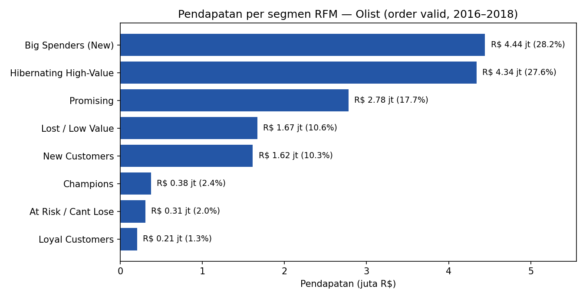
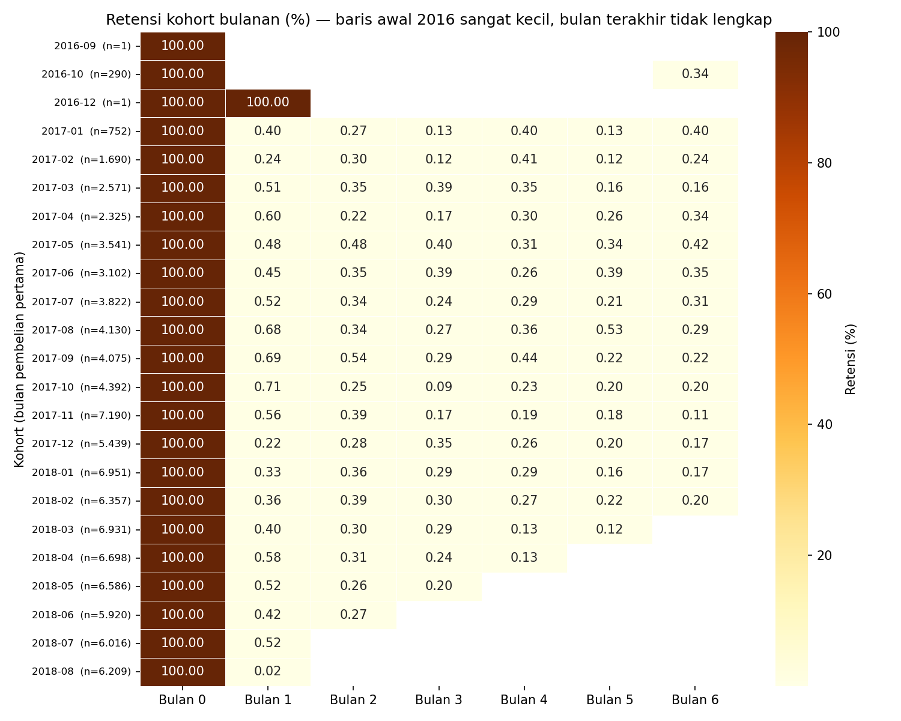

# E-Commerce Customer Analytics: RFM Segmentation & Cohort Retention (SQL)

> Customer segmentation (RFM) and monthly cohort retention analysis on ~100K real e-commerce orders, built with PostgreSQL.

**Tools:** PostgreSQL · (optional) Power BI / Looker Studio / Tableau for visualization
**Dataset:** [Olist Brazilian E-Commerce Public Dataset](https://www.kaggle.com/datasets/olistbr/brazilian-ecommerce) (~100K orders, 2016–2018, real anonymized data)

## Business Questions
1. Who are the most valuable customers, and how much revenue do they contribute?
2. How well does the store retain customers after their first purchase?
3. Which segments deserve priority for marketing actions?

## Repository Structure
```
sql/
  01_schema_and_load.sql      -- DDL + CSV loading
  02_data_quality_checks.sql  -- data validation + clean base view
  03_rfm.sql                  -- RFM scoring + segmentation
  04_cohort_retention.sql     -- monthly cohorts + retention pivot
data/                         -- place CSV files here (not committed)
output/                       -- query results from the documented run (CSV + psql logs)
dashboard/                    -- charts built from the query results
```

## Key Analytical Decisions
| Issue in the raw data | How it was handled |
|---|---|
| `customer_id` is unique per order, not per person | Used `customer_unique_id` as the true customer key |
| One order can have multiple payment rows | Aggregated payments per order before joining to avoid double counting |
| `canceled` / `unavailable` orders | Excluded |
| Most customers purchase only once, so NTILE on Frequency is meaningless | Rule-based Frequency score (1x / 2x / 3x+) |
| Earliest cohorts are tiny and the last months are incomplete | Excluded from conclusions |
| Snapshot date | `MAX(order_date) + 1`, not today's date |

## How to Run
1. Download the dataset from Kaggle (or the official Olist mirror on GitHub, see `data/README.md`) and create a PostgreSQL database.
2. Run the files in `sql/` in order (01 → 04).
3. Connect the `rfm_segments` and `cohort_retention` tables to your BI tool.

## Results & Insights
All numbers below are the actual output of running the queries in this repo on PostgreSQL 16 (logs and CSVs in `output/`). Clean base: **94,989 customers** and **R$15,739,137** revenue from valid orders (Sep 2016 – Oct 2018).

- **Repeat rate:** only **3.04% of customers purchased more than once**; 96.96% bought exactly once (query #6 in file 02). There are 99,441 `customer_id` values but only 96,096 real customers (`customer_unique_id`).
- **Largest segment by customers:** Lost / Low Value — 24.1% of customers but only 10.6% of revenue (avg spend R$72.79, last purchase ~402 days before the snapshot).
- **Largest segment by revenue:** Big Spenders (New) — 15.4% of customers producing **28.2% of revenue** (R$4,443,022, avg spend R$303.61). Together with Hibernating High-Value (14.8% of customers, 27.6% of revenue, avg recency 401 days), **two segments hold 55.8% of all revenue from 30.2% of customers**, and both are one-time buyers.
- **True repeat buyers are rare:** Champions + Loyal Customers + At Risk together are just 3.1% of customers and 5.7% of revenue.
- **Month-1 retention:** average **0.48%**, dropping to **0.26% by month 3** (average across 15 monthly cohorts, Jan 2017–Mar 2018, each with ≥500 customers and a fully observable window; tiny 2016 cohorts and the incomplete tail are excluded).





- **Key finding:** most revenue comes from one-time buyers and retention is close to zero, so the business priority is converting the second purchase, not just acquisition. The single biggest recoverable pool is Hibernating High-Value: R$4.34 million of historical spend sitting idle for over a year.

Full segment table:

| Segment | Customers | % Customers | Revenue (R$) | % Revenue | Avg Recency (days) | Avg Monetary (R$) |
|---|---|---|---|---|---|---|
| Big Spenders (New) | 14,634 | 15.4 | 4,443,022 | 28.2 | 98 | 303.61 |
| Hibernating High-Value | 14,023 | 14.8 | 4,341,365 | 27.6 | 401 | 309.59 |
| Promising | 18,388 | 19.4 | 2,779,402 | 17.7 | 226 | 151.15 |
| Lost / Low Value | 22,936 | 24.1 | 1,669,459 | 10.6 | 402 | 72.79 |
| New Customers | 22,120 | 23.3 | 1,615,355 | 10.3 | 96 | 73.03 |
| Champions | 1,012 | 1.1 | 376,966 | 2.4 | 95 | 372.50 |
| At Risk / Cant Lose | 1,037 | 1.1 | 308,231 | 2.0 | 389 | 297.23 |
| Loyal Customers | 839 | 0.9 | 205,337 | 1.3 | 188 | 244.74 |

## Business Recommendations
| Segment | Recommended Action |
|---|---|
| Champions / Loyal | Loyalty program, early access to new products; protect this small base, it is only 2.0% of customers |
| Big Spenders (New) / New Customers | Second-purchase voucher soon after the first order; this is where 38.5% of revenue sits with no repeat yet |
| Hibernating High-Value | Highest-priority win-back campaign (email/WhatsApp with a strong incentive); R$4.34M historical spend, idle ~401 days |
| At Risk / Cant Lose | Win-back before they lapse fully; high past spend (avg R$297) but last purchase ~389 days ago |
| Promising | Nurture with recommendations and free-shipping thresholds to lift the second and third order |

## Future Improvements
- Simple CLV per segment
- Delivery delay vs. retention analysis (join `order_reviews` and delivery dates)
- Cohorts by product category or state

## Related Projects
- [Customer Churn Prediction for a Telecom Provider](https://github.com/andikapratamazaid/telco-churn-prediction)
- [Fraud Detection in Online Card Transactions](https://github.com/andikapratamazaid/fraud-detection-card-transactions)

## Author
**Andika Pratama Zaid** · [LinkedIn](https://linkedin.com/in/andikapratamazaid) · [GitHub](https://github.com/andikapratamazaid)
